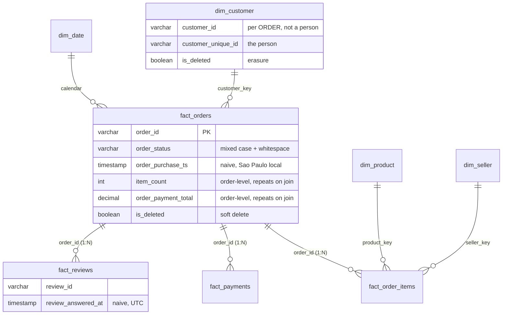
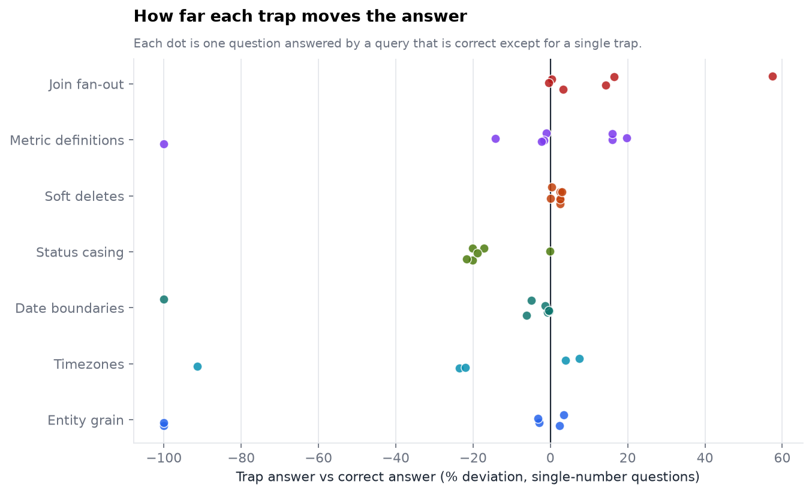
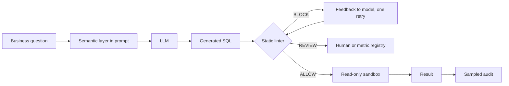

# The Analyst's Copilot Audit

**Can an LLM be trusted to answer business questions straight off a data warehouse, and what has to be true before it can?**

   

This repository is an audit, not a demo. It builds a warehouse full of realistic traps on top of about 100,000 real marketplace orders, defines what "correct" means for it, measures how far plausible SQL drifts from that definition, names each way it drifts, and turns the findings into rules about what may be automated.

## Project at a glance

The repository is designed to answer a practical engineering question: **when should an analytics team trust SQL written by a language model, and when should it require review or a governed metric?**

| Capability | Implementation |
|---|---|
| Warehouse | DuckDB star schema built from the public Olist marketplace dataset |
| Evaluation | Gold SQL, result-set comparison, adversarial trap queries, and independently derived checks |
| Context experiment | Four cumulative prompt conditions, from schema-only context through metric definitions and lint feedback |
| SQL safety | SQL AST inspection, read-only execution, timeouts, and row limits |
| Error analysis | Failure taxonomy for silent logic errors and execution failures |
| Reporting | Accuracy intervals, paired comparisons, latency, token usage, estimated cost, and automation recommendations |

The project separates **offline validation** (which needs no model API) from **live model evaluation** (which makes external API calls). The reported benchmark section below remains intentionally empty until a live run has produced results.

## What was tested, and how

| | |
|---|---|
| **Warehouse** | DuckDB star schema on the public Olist e-commerce dataset, with soft deletes, dirty statuses, mixed timezone conventions, one-to-many fan-out, a per-order customer id, and metrics with two defensible definitions |
| **Questions** | 80 development questions in 8 families with gold SQL and results, plus a **16-question holdout** written afterwards in different styles, with evasive wrong queries and unusually written correct ones |
| **Correctness** | Result-set equivalence, never SQL string match; validated by 19 comparator tests, 21 alternative correct formulations, and 12 independent pandas re-derivations from the raw CSVs |
| **Experiment** | Four cumulative prompt conditions: DDL only (C0), plus column descriptions (C1), plus rules and metric definitions (C2), plus a lint-and-retry guardrail (C3). Same questions, paired comparison, Wilson and bootstrap intervals, cost and latency per query |
| **Outputs** | A failure taxonomy, a SQL guardrail with measured detection, prevention, recovery and false-block rates, and a per-family automation policy |


## The three worst failures, measured

Each pair differs by one realistic mistake, run against the real data. Nothing here involves a model.

**1. Join fan-out: +57.4%, no error.** *Freight on voucher-paid orders.* Joining the payments table multiplies items per payment row.

```sql
-- correct: 77,770                                  -- plausible: 122,425
SELECT sum(i.freight_value)                         SELECT sum(i.freight_value)
FROM fact_order_items i                             FROM fact_order_items i
JOIN fact_orders o ON o.order_id = i.order_id       JOIN fact_orders o   ON o.order_id = i.order_id
WHERE NOT o.is_deleted                              JOIN fact_payments p ON p.order_id = o.order_id
  AND EXISTS (SELECT 1 FROM fact_payments p         WHERE NOT o.is_deleted
     WHERE p.order_id = o.order_id                    AND p.payment_type = 'voucher'
       AND p.payment_type = 'voucher')
```

**2. Entity grain: repeat customers 2,840 reported as 0.** `customer_id` is assigned per order, so grouping by it makes every customer look like a one-time buyer.

**3. Business-definition drift: revenue off by 16.1%.** "Revenue in 2017" is 5,817,341 as item price and 6,753,471 as payments received. Both are defensible; only one is the company's definition. The same warehouse also turns "active customers" into **0** if the query uses `CURRENT_DATE` on a 2018 snapshot.

The smallest error is the most dangerous: omitting the soft-delete filter overstates orders by only **2.5%**, which survives a sanity check and compounds through every downstream report.

## What to do about it

1. **Do not allow unsupervised generation** that joins two of `fact_order_items`, `fact_payments`, `fact_reviews` in one query. Expose pre-aggregated order-grain views.
2. **Answer registered metrics from governed SQL,** not generation: revenue, cash, AOV, active customers, late-delivery rate.
3. **Publish filtered views** so soft-delete and erasure predicates cannot be forgotten.
4. **Fix the data before the prompt:** typed timestamps, clean status values, and a person key that is not called per-order.
5. **Treat the guardrail as a tripwire, not a proof.** On the holdout it flagged 29 of 32 wrong variants but let evasive ones through and could not see intent-dependent date bounds (see [Guardrails](#guardrails)).
6. **Promote nothing to automation on a small sample.** Even 14 of 14 correct answers only supports a 78% lower bound; the policy below requires a 90% lower bound.

---

## Quick start

Needs **Python 3.10 or newer** and about 400 MB of disk. No database server, no Docker, no API key for steps 1 to 3.

**1. Set up (about 2 minutes, downloads ~60 MB of public data)**

| Windows | macOS / Linux |
|---|---|
| Unzip the folder, then double-click `setup.bat` (or run it in Command Prompt / PowerShell) | `cd analyst-copilot-audit` then `bash setup.sh` |

This creates a private `.venv`, installs the dependencies, downloads the Olist CSVs, builds the DuckDB warehouse and measures every trap. It ends with an environment check.

**2. Activate the environment in a new terminal, then run the tests and the offline demo**

```
# Windows (Command Prompt)          # Windows (PowerShell)                 # macOS / Linux
.venv\Scripts\activate              .venv\Scripts\Activate.ps1             source .venv/bin/activate

python -m pytest -q                 # 115 tests, about 40 s
python -m copilot_audit doctor      # shows what is installed and what is missing
python -m copilot_audit selftest    # runs the full pipeline with scripted providers
```

PowerShell may refuse to run the activation script; if so, run `Set-ExecutionPolicy -Scope CurrentUser RemoteSigned` once, or use Command Prompt.

**3. Explore the warehouse yourself**

```
python -c "import duckdb; c=duckdb.connect('data/warehouse.duckdb', read_only=True); print(c.sql('select lower(trim(order_status)) s, count(*) from fact_orders group by 1 order by 2 desc'))"
```

Open `results/trap_impact.json` and `docs/img/` for the measured trap results.

**4. Evaluate a real model (needs an Anthropic API key)**

Copy `.env.example` to `.env` and paste your key after `ANTHROPIC_API_KEY=`. Then:

```
python -m copilot_audit smoke       # 10 questions, 2 conditions, a few cents
python -m copilot_audit run         # full evaluation: 80 questions x C0..C3
python -m copilot_audit report      # writes results/REPORT.md and the charts
```

Responses are cached in `results/cache`, so an interrupted run resumes without paying twice. Every command is plain `python -m copilot_audit ...`; the Makefile is an optional shortcut for macOS / Linux.

**If something fails:** run `python -m copilot_audit doctor`. It names the missing piece and the command that fixes it. If the data download is blocked by a firewall, download the dataset from [Kaggle](https://www.kaggle.com/datasets/olistbr/brazilian-ecommerce) and unzip the CSVs into `data/raw/`, then run `python -m copilot_audit build`.

---

---

## API access, cost control, and secrets

Live generation currently uses the Anthropic API through the provider adapter in `copilot_audit/llm.py`. A ChatGPT subscription does not include API credits, and API calls may incur charges. The repository does not assume that a free quota is available. If you use a provider's free tier, check its current rate limits, model availability, and data-use terms before running the benchmark; a different provider requires a compatible adapter rather than only changing the API key.

- Start with `python -m copilot_audit smoke` to test a small number of calls.
- Use `--limit N` on `run` while debugging, then run the full set after confirming the configuration.
- Responses are cached under `results/cache/` to reduce duplicate calls after interruptions. The cache is local and ignored by Git.
- Put credentials in `.env`, never in source files, notebooks, screenshots, or commits. `.env` is ignored by `.gitignore`; commit only `.env.example`. If a key is exposed, revoke it with the provider and create a new one.


## Contents

1. [The warehouse and its traps](#the-warehouse-and-its-traps)
2. [What each trap does to the answer](#what-each-trap-does-to-the-answer)
3. [Failure taxonomy](#failure-taxonomy)
4. [Questions: development set and holdout](#questions-development-set-and-holdout)
5. [How correctness is judged, and how the judge is validated](#how-correctness-is-judged-and-how-the-judge-is-validated)
6. [Semantic-layer experiment](#semantic-layer-experiment)
7. [Guardrails](#guardrails)
8. [Automation policy](#automation-policy)
9. [Command reference](#command-reference)
10. [Repository layout](#repository-layout)
11. [Limitations and threats to validity](#limitations-and-threats-to-validity)
12. [Data and licence](#data-and-licence)

---

## The warehouse and its traps

**Source:** the [Olist Brazilian E-Commerce Public Dataset](https://www.kaggle.com/datasets/olistbr/brazilian-ecommerce): about 100,000 real, anonymised marketplace orders from 2016 to 2018 (CC BY-NC-SA 4.0). It is not redistributed here; `setup` fetches it.



Row counts: 99,441 orders, 112,650 items, 103,886 payments, 99,224 reviews, 99,441 customer records (96,096 distinct people), 32,951 products, 3,095 sellers. The build reconciles to Olist's published totals.

### Where the traps come from

| Trap | Where it lives | Origin | Why a model misses it |
|---|---|---|---|
| **Fan-out** | `fact_orders` 1:N `fact_order_items` / `fact_payments` / `fact_reviews`; order-level `item_count`, `order_payment_total` | Native cardinalities; the order-level columns are a typical warehouse denormalisation | Every join is *valid*; the multiplication only shows in the sum |
| **Soft deletes** | `fact_orders.is_deleted` (2.5%), `dim_customer.is_deleted` (1.5% of people) | **Injected**, seeded hash of the key | Nothing in the question mentions deletion |
| **Status casing** | `fact_orders.order_status`: 8 real values appear as 32 spellings (20% noise) | **Injected** | `= 'delivered'` looks right and returns 80% of the truth |
| **Naive timestamps** | Order times are Sao Paulo local; `fact_reviews.review_answered_at` is UTC; both are plain `TIMESTAMP` | Local convention native; the UTC review column is **injected** via a proper tz conversion | The type says nothing; only documentation does |
| **Two metric definitions** | revenue (item price vs payments), active customer (window, statuses), late delivery (timestamp vs date), GMV, AOV | Native ambiguity | Both readings are reasonable; one is the contract |
| **Per-order customer id** | `dim_customer.customer_id` is assigned per order | Native to Olist | The column is *called* `customer_id` |
| **Dirty dimension data** | 623 products without a category, `not_defined` payment type, orders with no items or no payments | Native | Silent NULL and zero handling |

Injection is deterministic (`md5(seed:salt:key)`), so every build is byte-for-byte reproducible and recorded in `data/trap_manifest.json`. Rates are named constants in `warehouse.py`.

---

## What each trap does to the answer

| Trap | Question | Correct | With the mistake | Error |
|---|---|---:|---:|---:|
| Fan-out (items x payments) | Freight on voucher-paid orders | 77,770 | 122,425 | **+57.4%** |
| Fan-out | 2017 payments received, joined with item revenue | 6,753,471 | 8,676,053 | **+28.5%** |
| Fan-out | Average payment of multi-item orders | 249.67 | 290.71 | +16.4% |
| Metric definition | Revenue in 2017 as payments instead of item price | 5,817,341 | 6,753,471 | +16.1% |
| Metric definition | Late-delivery rate, timestamp vs calendar-date rule | 6.78% | 8.12% | +19.8% |
| Entity grain | Repeat customers, counting `customer_id` | 2,840 | **0** | -100% |
| Relative date | Active customers using `CURRENT_DATE` | 17,537 | **0** | -100% |
| Date boundary | Orders on 24 Nov 2017, `ts = DATE` | 1,148 | **0** | -100% |
| Timezone | Busiest local hour for review replies | 23:00 | 02:00 | 3 h off |
| Status casing | Delivered orders, raw string compare | 94,093 | 75,123 | -20.2% |
| Soft delete | Total orders, filter omitted | 96,989 | 99,441 | **+2.5%** |



The worst single order has 21 items, so an order-level payment total joined to items is counted 21 times. 9.9% of orders have more than one item, 3.0% more than one payment, 0.6% more than one review. The soft-delete, status and UTC-review magnitudes reflect injected rates (2.5%, 20%, all reviews), which are design parameters; the mechanisms and directions are real.

---

## Failure taxonomy

Eleven classes, eight of them **silent** (the query runs and returns numbers a dashboard would display):

| Class | Silent | Layer that owns the fix |
|---|:-:|---|
| `FANOUT_INFLATION` | yes | modelling |
| `SOFT_DELETE_IGNORED` | yes | data contract |
| `DEFINITION_DRIFT` | yes | semantic layer |
| `ENTITY_GRAIN_ERROR` | yes | modelling |
| `DATE_BOUNDARY_ERROR` | yes | SQL craft |
| `TIMEZONE_MISMATCH` | yes | data contract |
| `STATUS_CASE_MISMATCH` | yes | data quality |
| `UNATTRIBUTED_LOGIC_ERROR` | yes | model |
| `SCHEMA_HALLUCINATION` | no | model |
| `SYNTAX_OR_RUNTIME_ERROR` | no | model |
| `BLOCKED_UNSAFE_OR_TIMEOUT` | no | platform |

Most silent failures are fixed by a better warehouse (a `TIMESTAMPTZ`, a filtered view), not a better model. `UNATTRIBUTED_LOGIC_ERROR` is kept deliberately visible: it is the share of real failures the taxonomy cannot yet explain, and every report prints it. Class-by-class examples with real numbers are in [`docs/taxonomy.md`](docs/taxonomy.md).

---

## Questions: development set and holdout

**Development set: 80 questions.** The traps and the linter were designed together, so agreement here is partly circular.

| Family | Questions | What it probes |
|---|---:|---|
| Controls (no trap) | 14 | Dimension-only lookups |
| Soft deletes | 10 | Order-level and customer-level deletion flags |
| Status casing | 8 | Counts, distributions, ratios on a dirty categorical |
| Join fan-out | 14 | Orders per category, voucher freight, side-by-side revenue and payments |
| Date boundaries | 8 | Quarter, month, single-day and week ranges on TIMESTAMPs |
| Timezones | 6 | Local day, hour, month and elapsed-time questions |
| Metric definitions | 12 | Revenue, GMV, cash, AOV, active customers, late rate, freight ratio |
| Entity grain | 8 | Customers, repeat rate, orders per customer |

**Holdout: 16 questions, 32 wrong variants, 5 unusual correct variants.** Written after the rules, in different phrasing and SQL styles. 11 of the wrong variants are *evasive*: fan-out hidden inside a CTE or derived table, exclusive date bounds, `IN ('delivered','shipped')` for revenue, grouping by `customer_key`. The correct variants use idioms the rules had not seen (`deleted_at IS NULL`, `ILIKE '%shipped%'`, a primary-key-restricted join). The holdout can be run against a model too: `--set holdout`.

---

## How correctness is judged, and how the judge is validated

Execution accuracy by **result-set equivalence**. Column names and order are ignored, extra columns are tolerated, numbers are held to the gold answer's precision (fractional columns never looser than two decimals), and ordering matters only when the question asks for it. Duplicate-row multiplicity is respected, so a fan-out error cannot be certified by a result with the same distinct rows. Ambiguous column assignments are resolved by search over row alignment. Full rules in [`docs/methodology.md`](docs/methodology.md).

| Check | Result |
|---|---|
| Comparator unit and adversarial tests (multiplicity, constant columns, ambiguous columns, NaN, empties, ties, decimals) | 19 pass |
| Every trap query returns a result different from gold | 66 / 66 |
| Independently written correct formulations accepted | 21 / 21 development, 5 / 5 holdout |
| Independent pandas re-derivation of gold from raw CSVs | 12 checks pass |
| Warehouse reconciles to Olist published totals | yes |
| Tie order in ordered results | strict by design; every ordered question states its tie-break |

---

## Semantic-layer experiment

| Condition | Adds | Question it answers |
|---|---|---|
| **C0** | `CREATE TABLE` only | What a naive text-to-SQL demo achieves |
| **C1** | column descriptions, per-table grain, timezone convention | Does saying *what columns are* help? |
| **C2** | warehouse rules and 7 defined metrics with canonical SQL | Does saying *what they mean here* help? |
| **C3** | C2 plus lint-and-retry | What does a guardrail loop buy, and what does it cost? |

Controls: identical questions, model and settings in every condition; paired analysis by question (the question, not the trial, is the unit); exact McNemar test and paired bootstrap interval for each lift; Wilson interval for each accuracy; `--trials N` with a per-trial stability report; prompt hashes, environment and question-set hash stored in each run's `meta.json`. C3 latency and cost include the retry call. Metrics reported: accuracy, silent-error rate, risk-weighted error (money and registered-metric questions weighted 3x), cost per question, and mean, median and p95 latency.

---

## Guardrails



The linter parses SQL with `sqlglot` and reasons about structure, including lineage through CTEs and derived tables. The sandbox opens the database read-only, accepts one SELECT, disables file access, locks configuration, and enforces a timeout and row cap. Rules are listed in [`docs/guardrails.md`](docs/guardrails.md).

**Four measures, reported separately.** Detection (wrong answers flagged), prevention (wrong answers blocked), recovery (retry turned a blocked wrong answer into a correct one) and false blocks (correct answers blocked), plus regressions (retry broke a correct answer). `results/REPORT.md` computes all five from real generations.

**Development set** (written alongside the rules; a regression suite, not an estimate):

| Population | n | ALLOW | REVIEW | BLOCK |
|---|---:|---:|---:|---:|
| Gold queries | 80 | 60 | 20 | **0** |
| Correct alternate formulations | 21 | 18 | 3 | **0** |
| Trap queries | 66 | 7 | 16 | 43 |

The 20 REVIEW decisions on gold are the revenue-like-aggregate rule, which sends money metrics to the registry by policy.

**Holdout** (first measured before any rule changed, then fixed and re-measured):

| Measure | v1, frozen | v2, after fixes |
|---|---:|---:|
| Wrong variants flagged | 27 / 32 | 29 / 32 |
| Wrong variants blocked | 18 / 32 | 20 / 32 |
| Plain variants flagged / blocked | 21 / 21, 16 / 21 | 20 / 21, 15 / 21 |
| **Evasive variants flagged / blocked** | **6 / 11, 2 / 11** | **9 / 11, 5 / 11** |
| **False blocks on correct SQL** | **3 / 5** | **0 / 5** |
| Classifier agreement with labels | 24 / 32 | 30 / 32 |

What the holdout found, honestly:

- **The linter had real defects, not just blind spots.** It blocked three correct queries (`deleted_at IS NULL`, `ILIKE '%shipped%'`, a join pinned to `payment_sequential = 1`) and missed fan-out hidden in CTEs. Those were fixed, each with a regression test. The v1 numbers are kept in `results/holdout_v1.json` and pinned by a test so history cannot be rewritten.
- **v2 is no longer a holdout.** It was tuned on the same variants; its numbers show the fixes work, not that recall is 90%.
- **One variant was mislabelled by the author** (H03, wrong because of `item_count >= 3`, not fan-out). It is corrected in v2 and noted here; it explains why 29 / 32 includes one variant outside the taxonomy.
- **Two blind spots remain by design.** Exclusive date ends such as `< '2018-03-15'` for "1 to 15 March inclusive" depend on intent, so a syntax rule cannot catch them (H08, H09). A test asserts they are still missed so the gap stays visible. Remedy: confirm date intent with the user or probe boundary rows.
- **Intent-dependent errors need the registry.** Four dev-set trap queries that count rows where the question asked for orders, and three that apply a different metric definition, are allowed by a question-agnostic linter.

---

## Automation policy

Tiers are computed per family from a run, with the question as the unit and the statistics shown:

| Tier | Rule |
|---|---|
| **AUTOMATE with sampled audit** | Wilson 95% lower bound >= 90% **and** zero silent failures |
| **HUMAN REVIEW** | Accuracy >= 80%, or accuracy >= 95% on too few questions to certify (the report states how many are needed) |
| **BLOCK free-form SQL** | Accuracy below 80%: use the registry or governed views |
| **REGISTRY ONLY** | Metric-definition questions, always |

A family of 14 questions at 100% has a lower bound of 78%, so it cannot be certified; about 35 questions at 100% are required. With 6 to 14 questions per family, the current bank will almost always place families under human review. That is the correct, conservative outcome, and the way to change it is more questions, not a softer threshold.

Structural recommendations that hold whatever a model scores: see [What to do about it](#what-to-do-about-it) and [`docs/guardrails.md`](docs/guardrails.md).

---

## Command reference

| Command | What it does | API key |
|---|---|:-:|
| `python -m copilot_audit setup` | download data, build warehouse, measure traps, draw figures | no |
| `python -m copilot_audit doctor` | environment check | no |
| `python -m copilot_audit traps` | development-set trap impact, classifier, guardrail | no |
| `python -m copilot_audit holdout` | holdout linter and classifier measurement | no |
| `python -m copilot_audit selftest` | pipeline end to end with scripted providers | no |
| `python -m pytest -q` | 115 tests | no |
| `python -m copilot_audit smoke` | 10 live questions | yes |
| `python -m copilot_audit run --set all --trials 3` | full evaluation, development plus holdout | yes |
| `python -m copilot_audit report` | `results/REPORT.md` and figures | no |
| `python -m copilot_audit publish` | write real results into this README | no |

To evaluate another model, pass `--model`; to add another provider, subclass `llm.Provider` (one method, `generate`). Running a second model family and comparing is the strongest available test of generalisation.

---

## Repository layout

```
copilot_audit/
  warehouse.py   build the star schema, overlay seeded traps       executor.py   read-only sandbox
  compare.py     result-set equivalence                           lint.py       AST guardrail rules + metric conformance
  taxonomy.py    failure classes                                  classify.py   attribute each wrong answer
  semantic.py    prompt tiers C0-C3                               llm.py        Anthropic + scripted providers, cache
  runner.py      generate, guardrail loop, execute, compare       report.py     figures, REPORT.md, policy
  trap_impact.py development-set measurements                     holdout.py    holdout measurements
  publish.py     write real results into README                   stats.py      Wilson, McNemar, paired bootstrap
questions/       80 development questions, alternates.yaml, holdout.yaml (16 questions)
semantic/        semantic_layer.yaml: column docs, rules, metric definitions
tests/           115 tests incl. independent pandas reconciliation and a synthetic multi-condition report run
docs/            methodology.md, taxonomy.md, guardrails.md, img/
results/         trap_impact.json, holdout_v1.json (frozen), holdout.json, SELFTEST_REPORT.md, runs/
```

---

## Limitations and threats to validity

- **No live-model numbers are included yet.** The pipeline that produces them is tested end to end, including a synthetic multi-condition run with known accuracy, but the benchmark itself needs your API key.
- **Same author for traps, rules and holdout.** The holdout was written after the rules and to evade them, which is more honest than the development set, but it is not independent. Independent validation needs another author's questions and a second model family's outputs.
- **Injected rates are design parameters.** Soft deletes (2.5%), status noise (20%) and the UTC review column are overlays; fan-out cardinalities, the per-order customer id, naive timestamps and metric ambiguity are native to Olist.
- **Small per-family samples** (6 to 14) make family tiers provisional; the policy rules are built around that.
- **Gold answers encode this warehouse's contract.** A model that picks the other plausible definition is wrong here, which is the claim under test.
- **Static analysis cannot prove semantic correctness.** Intent-dependent errors and some evasive forms pass; result-set comparison is the backstop in evaluation, and a human or registry is the backstop in production.
- **Risk weights are a simple heuristic** (3x for money or registered metrics); adjust `questions.risk_weight` to your own cost of error.
- **Ordered results compare tie order strictly;** this is why every ordered question states its tie-break.
- **One schema, one SQL dialect.** E-commerce star schema, DuckDB.

**Verified reproduction.** From an unzipped copy, in a brand-new virtual environment, on Linux with Python 3.12: data download, warehouse build (about 10 seconds) and the full test suite pass, including with Python forced to a plain-ASCII default encoding. Windows and macOS were not available to test; `python -m copilot_audit doctor` reports anything missing. `requirements.lock.txt` pins the versions used.

---

## Data and licence

Code: MIT. Data: Olist Brazilian E-Commerce Public Dataset, **CC BY-NC-SA 4.0**, fetched at build time and not redistributed. The licence is non-commercial and share-alike, and it also applies to datasets derived from it, including the built warehouse and the gold answers. Do not use them in a commercial product or publish derived data under different terms. Pricing in `config/pricing.yaml` should be re-checked against the [Anthropic pricing page](https://platform.claude.com/docs/en/about-claude/pricing) before quoting costs.

## Reproducibility checklist

Before sharing benchmark numbers, record the model identifier, run tag, question set, conditions, trial count, and the generated `meta.json`. Use the same question IDs and settings when comparing conditions. Do not mix scripted self-test runs with live model runs, and do not report point estimates without the uncertainty intervals produced by the report. The holdout v1 artifact is retained as a historical measurement; after the rules were tuned against its cases, later measurements are regression evidence rather than an untouched holdout estimate.

## Contributing and issue reports

Useful contributions include new independently authored questions, additional correct SQL formulations, regression tests for guardrail misses, provider adapters, and improvements to result-set equivalence. When reporting a failure, include the question ID, run metadata, relevant SQL with secrets removed, and the expected versus observed result. Do not upload API keys or private customer data. See [`CONTRIBUTING.md`](CONTRIBUTING.md) for the lightweight workflow.

